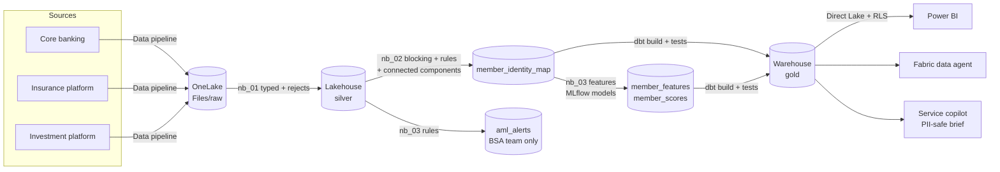

# Credit Union Member 360 on Microsoft Fabric

**One trusted view of each member across banking, lending, insurance and investments, ready for BI, ML and AI copilots.**

[](https://github.com/SykamVenkata/credit-union-member360-fabric/actions/workflows/ci.yml)

A credit union runs its core banking, insurance and investment platforms as separate systems, and they share no member key. As a result:
- the same person can appear as "Robert Smith" in core banking, as "BOB SMITH" with a work email in insurance, and with a reformatted phone number in investments
- nobody can say how many products a member really holds
- the retention team can't see who is drifting away
- a service agent can't see the whole relationship

This project resolves those identities into one **golden member** and builds a Member 360 on top. It then puts the Member 360 to work in four places: a Direct Lake semantic model, churn and next-best-product models, AML transaction monitoring, and a PII-safe brief for a member-service copilot. All data is synthetic.



## Results on the sample (800 members, 3 systems)

| | |
|---|---|
| Identity resolution | **100% precision, 98.4% recall** (pairwise, measured against ground truth that the pipeline never sees). It produces 800 golden members and 71 prospects who hold insurance but aren't members. |
| Churn model (90-day) | **AUC 0.88, 4.5x top-decile lift** over a 9.4% base rate |
| AML monitoring | Found all 10 planted structuring and rapid-movement cases |
| Member 360 | 3.3 products per member, 73% of members hold products in 2+ domains, 81% are digitally active |

Run `make run` to reproduce these figures.

## What it demonstrates

| Area | How | Where |
|---|---|---|
| **Entity resolution** | Records are standardized (nicknames, email case, phone formats, DOB formats). Pairs are compared only within shared email, shared phone, or DOB plus last-name soundex. Explainable rules decide matches, a DOB conflict vetoes any match, and union-find clusters the results. Match quality is measured, not assumed. | [`identity.py`](src/creditunion/identity.py) · [`nb_02`](fabric/notebooks/nb_02_identity_resolution.py) |
| **Scaling the matcher** | The same Python rules run on Spark. Blocking keys are exploded, pairs are compared per block with `applyInPandas`, oversized blocks are skipped, and every merge is written to a match log for audit. | [`nb_02`](fabric/notebooks/nb_02_identity_resolution.py) |
| **Member 360** | Point-in-time features with no label leakage: tenure, balances, activity trend, digital engagement, products per domain, delinquency, claims, AUM and a lifetime-value proxy. | [`member360.py`](src/creditunion/member360.py) |
| **ML** | The churn model is gradient boosting with a model card; protected-attribute proxies are excluded on purpose. Next-best-product scores each product separately and checks eligibility, so a member already 30+ days past due is never offered new credit. Both are logged to MLflow. | [`models.py`](src/creditunion/models.py) · [`nb_03`](fabric/notebooks/nb_03_member360_scoring.py) |
| **AML monitoring** | Rules detect structuring under the $10K CTR threshold, rapid in-and-out movement and dormant-account reactivation. Each alert carries its evidence, and alerts are kept away from front-line staff and copilots (tipping off). | [`aml.py`](src/creditunion/aml.py) |
| **AI-ready** | The copilot brief is built from an allow-list: balances are bucketed, contact details are masked, and there is no DOB and no AML data. The churn risk is marked INTERNAL. A Fabric data agent is limited to gold tables, with grounding instructions and example SQL. | [`copilot.py`](src/creditunion/copilot.py) · [`data_agent/`](fabric/data_agent) |
| **dbt on Fabric Warehouse** | Staging models, gold marts (`dim_member`, `fct_member_product`, `mart_member_360`), source freshness checks, generic tests and custom tests for identity completeness and RLS integrity. | [`fabric/dbt/`](fabric/dbt) |
| **Semantic model** | Direct Lake with branch and region row-level security. Measures match the Python KPI definitions, and churn scores are hidden behind risk bands. | [`semantic_model/`](fabric/semantic_model) |
| **Orchestration** | A Fabric data pipeline lands the extracts, runs the notebooks in order, then triggers `dbt build`, with retries and failure alerts. | [`pl_member360_daily.json`](fabric/pipelines/pl_member360_daily.json) · [`dbt-build.yml`](.github/workflows/dbt-build.yml) |
| **Infrastructure and CI** | Terraform creates the Fabric capacity, workspace, Lakehouse (with schemas), Warehouse, environment and role assignments. CI runs lint, tests, a sample-reproducibility check, `dbt parse` and `terraform validate`. | [`infra/`](infra/terraform) · [`ci.yml`](.github/workflows/ci.yml) |

## Run it locally

```bash
pip install -e ".[dev]"
make run      # identity resolution → Member 360 → models → AML → KPIs; writes output/
make brief    # PII-safe copilot brief for the highest-risk member
make test     # 36 tests: matching rules, leakage, eligibility, AML typologies, PII, dbt/DAX consistency
make data     # regenerate data/sample (seeded, reproducible)
```

## Deploy to Fabric

```bash
cd infra/terraform && terraform init -backend-config=env/dev.backend.hcl && terraform apply -var-file=env/dev.tfvars
```

1. Build the wheel (`pip wheel . -w dist`) and attach it to `env_member360`.
2. Import the three notebooks and `pl_member360_daily`.
3. Add the Warehouse service principal secrets to the repo's `prod` environment for [`dbt-build.yml`](.github/workflows/dbt-build.yml).
4. Create the Direct Lake model over `wh_member360.gold`, using the measures and roles in [`semantic_model/`](fabric/semantic_model).

## Domain coverage

| Domain | Data | KPIs |
|---|---|---|
| Banking | members, deposit accounts, transactions, digital activity | members, deposit growth, digital adoption, Zelle usage |
| Lending | auto, personal, mortgage, HELOC, card, RV, student refi | loan balance, delinquency 30+, products per borrower |
| Insurance | auto, home, renters, life, umbrella policies and claims | active policies, loss ratio, cross-sell rate |
| Investments | advisor and robo-advisory accounts | AUM, robo adoption |
| Enterprise | Member 360, AML monitoring, retention | multi-domain share, value at risk, alerts by typology |

The full logical data model for retail banking is in [docs/retail-banking-data-model.md](docs/retail-banking-data-model.md). The design trade-offs are in [docs/design-decisions.md](docs/design-decisions.md).

## Repository layout

```
src/creditunion/     identity, member360, models, aml, copilot, kpis, pipeline (pure Python, tested)
fabric/notebooks/    nb_01 bronze→silver · nb_02 identity resolution · nb_03 features, scoring, AML
fabric/dbt/          staging + gold marts, tests, freshness (dbt-fabric)
fabric/pipelines/    Fabric data pipeline definition
fabric/semantic_model/  DAX measures, RLS roles, report pages
fabric/data_agent/   data agent config, instructions, example queries
infra/terraform/     Fabric capacity, workspace, lakehouse, warehouse, roles
data/generators/     synthetic multi-system data with identity noise and planted typologies
data/sample/         generated sample (800 members); _identity_truth.csv is for evaluation only
scripts/             run_local.py, brief.py
docs/                data model, design decisions, analytics lifecycle
```
